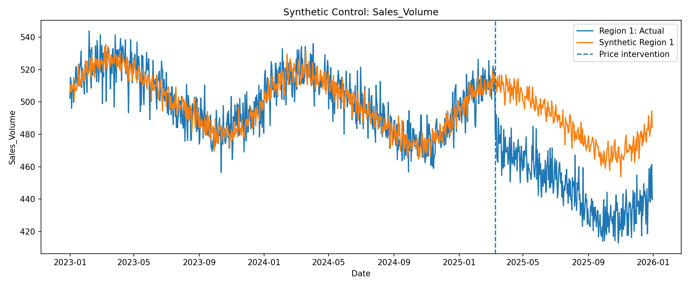
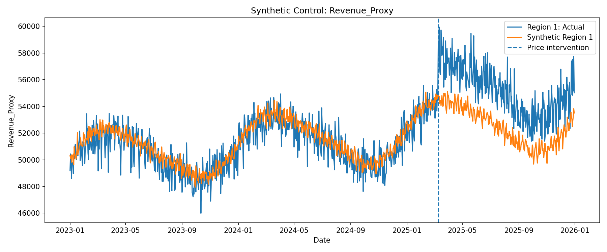

# Causal Inference & Synthetic Control for Algorithmic Pricing

A team data-analytics project that answers one business question:

> **A company raised the price in one region. Did that change cause sales and revenue to move, or would they have moved anyway?**

Ordinary before/after comparisons cannot answer this, because seasons, trends and market changes affect every region at once.
We use the **Synthetic Control Method**: build a "fake Region_1" from the regions that did *not* change price, and compare the real
region with its fake twin after the price change. The gap is the estimated causal effect.

> **Data note:** the dataset is **synthetic (simulated)**. The results show that the method works; they are not findings about a real company.

---

## Key results

Region_1 raised its price by **15 % on 2025-03-10**. We compare the 296 days after that date with the synthetic control.

| Outcome | Actual (avg/day) | Synthetic "no price change" (avg/day) | Effect | Status |
|---|---|---|---|---|
| **Sales volume** | 446.6 units | 486.0 units | **-39.4 units/day (-8.1 %)** | Validated: within 2.2 % of the true simulated effect |
| **Revenue proxy** (Price x Sales) | 55,134 | 52,450 | **+2,684/day (+5.1 %)** | Known issue: see below |





In plain words: the 15 % price rise cut sales by about 8 %, but because each unit sold for more, revenue still rose by about 5 %.
That is a rough price elasticity of about -0.5 (demand is fairly insensitive to price).

**Known issue (revenue number):** the saved revenue weights are a plain average of the 9 donor regions, not an optimised fit.
Fixing this (a 3-line change, tested) moves the revenue effect to about **+2,937/day (+5.6 %)**, closer to the true value of +2,867.
The direction and conclusion do not change. Details: [`docs/validation_report.md`](docs/validation_report.md).

---

## Project structure

```
data-analytics-team-project/
|-- README.md                          <- you are here
|-- data-preparation/
|   |-- Synthetic_Panel_Generators_Experimental.ipynb   (creates the dataset)
|   `-- synthetic_pricing_data.csv                      (10 regions x 1,095 days)
|-- causal-analysis/
|   |-- prepare_data.py                (adds Revenue_Proxy, saves analysis_ready_data.csv)
|   |-- synthetic_control.py           (builds the synthetic control, saves results/)
|   |-- placebo_test.py                (runs the placebo test on all regions)
|   |-- analysis_ready_data.csv
|   `-- results/                       (CSV tables and PNG charts)
|-- dashboard-creation/
|   |-- backend/                       (Flask API that serves the results)
|   `-- frontend/                      (React dashboard)
|-- validation/
|   |-- README.md                      (Member 4 module guide)
|   |-- validate_project.py            (54 automatic checks)
|   `-- validation_results.csv         (output of the last run)
`-- docs/
    |-- methodology.md                 (the methods in plain English)
    |-- data_dictionary.md             (every column and file explained)
    `-- validation_report.md           (what was checked, what was found)
```

---

## How to run

You need **Python 3.10+** and **Git**. (The dashboard frontend also needs a current LTS version of **Node.js**.)

### 1. Get the code

```powershell
git clone <paste the repository link from the green "Code" button>
cd data-analytics-team-project
```

### 2. Install the Python packages (one command covers everything)

```powershell
py -m venv .venv
.\.venv\Scripts\Activate.ps1
pip install -r dashboard-creation/backend/requirements.txt
```

On Mac / Linux use `python3 -m venv .venv`, `source .venv/bin/activate`, and `python3` instead of `py`.

### 3. Run the analysis (in this order)

```powershell
py .\causal-analysis\prepare_data.py
py .\causal-analysis\synthetic_control.py
py .\causal-analysis\placebo_test.py
```

Results appear in `causal-analysis/results/`.

### 4. Run the validation checks

```powershell
py .\validation\validate_project.py
```

It prints PASS / WARN / FAIL for each check and saves `validation/validation_results.csv`.
Add `--skip-rerun` to skip the slowest step (re-running the analysis scripts).

### 5. Start the dashboard

Terminal 1 (backend API, keep it running):

```powershell
cd dashboard-creation\backend
py app.py
```

Test it by opening http://127.0.0.1:5000/api/health in a browser: you should see `"backend": "running"` and `"success": true`, with all 6 files listed under `files_found` as `true`.

Terminal 2 (frontend):

```powershell
cd dashboard-creation\frontend
npm install
npm run dev
```

Open the address that Vite prints (usually http://localhost:5173).
*The frontend folder currently lacks `index.html` and `vite.config.js`; see Open items below.*

---

## Methods in one paragraph

For each outcome we find non-negative weights (adding up to 100 %) over the 9 untreated regions so that the weighted average tracks
Region_1 as closely as possible **before** the price change. After the change, the weighted average shows what Region_1 *would* have
looked like without it. The gap between real and synthetic is the effect. A **placebo test** repeats the procedure for every untreated
region to check that Region_1's gap is unusually large. See [`docs/methodology.md`](docs/methodology.md).

## Validation status

Module guides: [`causal-analysis/README.md`](causal-analysis/README.md) (Member 2), [`dashboard-creation/README.md`](dashboard-creation/README.md) (Member 3), [`validation/README.md`](validation/README.md) (Member 4).

54 automatic checks: **44 pass, 4 info, 4 warnings, 2 failures** (both failures come from the same revenue-weights issue).
The sales result matches the true simulated effect within 2.2 %. The dashboard API passes all 7 endpoint tests.
Full details: [`docs/validation_report.md`](docs/validation_report.md).

## Open items for the team

| # | Item | Owner |
|---|---|---|
| 1 | Revenue weights are not optimised (3-line fix in `synthetic_control.py`) | Causal analysis |
| 2 | `placebo_test.py` fits weights differently from `synthetic_control.py`; share one function | Causal analysis |
| 3 | Frontend needs `index.html` and `vite.config.js`; dashboard README mentions `my-app/`, real folder is `frontend/` | Dashboard |
| 4 | Double Machine Learning is not implemented (the data has the covariates for it). Decide: add it, or state the scope as Synthetic Control only | Whole team |

## Limitations

- Synthetic data: no real-world messiness, and the true effect is known only because we created it.
- Only one treated region and 9 donors, so the placebo p-value cannot go below 0.10 (1 out of 10).
- `Revenue_Proxy` is Price x Sales, so a price increase raises it by construction. Read the demand effect from `Sales_Volume`.

## Team

| Role | Member |
|---|---|
| Member 1: Data preparation | Pearl |
| Member 2: Causal analysis | Rashmitha M |
| Member 3: Dashboard | Suba |
| Member 4: Validation & documentation | Prathmesh Patil |
